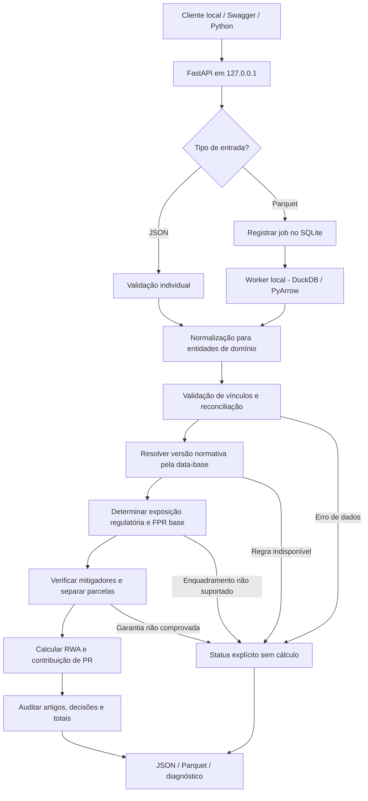
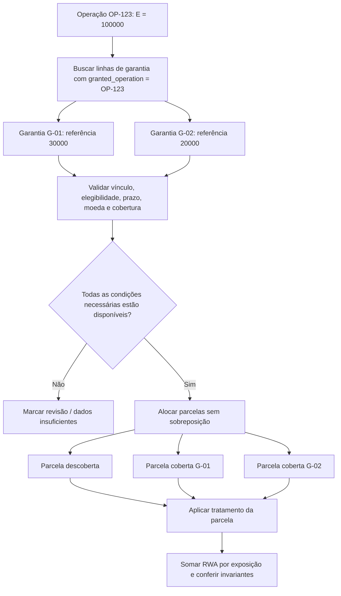
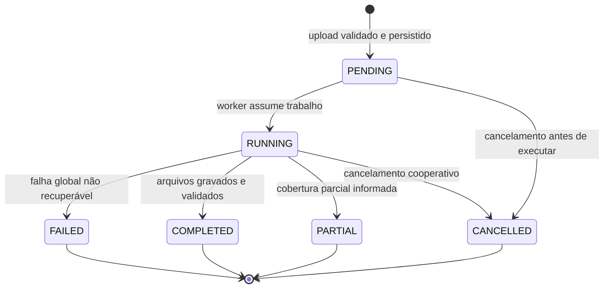
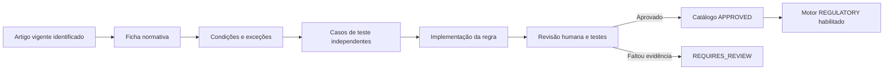
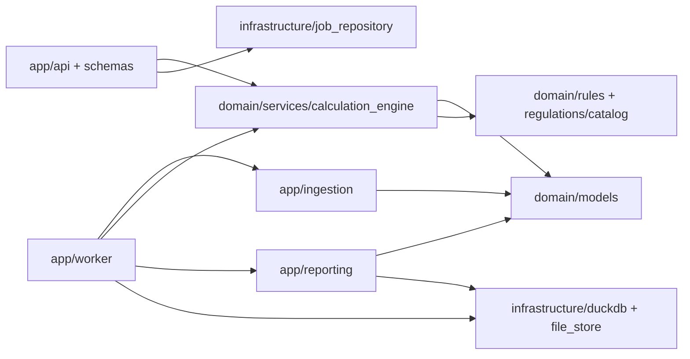

# APeX-API — Plano mestre de arquitetura e implementação

> **Documento de execução para o Cursor · versão 1.0 · 12/10/2026**  
> **Projeto:** APeX-API — API local de apoio ao cálculo prudencial de exposições de crédito, com processamento em lote, reconhecimento de mitigadores selecionados e rastreabilidade normativa.  
> **Estado deste documento:** especificação técnica e plano de trabalho, **não** declaração de que os cálculos já foram implementados ou validados pelo Banco Central.  
> **Idioma do código:** inglês para identificadores, português para documentação e respostas explicativas.  
> **Regra principal para o agente:** não inventar FPR, elegibilidade, haircut, FMR, prazo, fórmula, arredondamento ou interpretação regulatória. Se faltar fundamento normativo/data/atributo, retornar condição explícita de não cálculo.

---

## 0. Instruções obrigatórias ao Cursor (LEIA PRIMEIRO)

1. **Preservar o que existe.** O arquivo enviado pelo autor possui FastAPI funcional em `app/main.py`, endpoints `GET /`, `/health` e `/test/duckdb`, `README.md`, `LICENSE`, `requirements.txt` e `.gitignore`. Manter esses endpoints operacionais, sem exigir que componentes futuros estejam concluídos. A nova estrutura consiste predominantemente em **placeholders**, não em funcionalidades prontas.
2. **Não implementar tudo de uma vez.** Executar as fases do §18 na ordem. Antes de cada fase, apresentar arquivos a criar/editar, critérios de aceite e testes. Aguardar aprovação do autor quando uma decisão normativa ou de produto estiver em aberto.
3. **Priorizar corretude regulatória acima de cobertura e velocidade.** É proibido assumir FPR de 100% como fallback, utilizar zero para campo desconhecido ou calcular capital de carteira incompleta como se fosse total institucional.
4. **Separar fonte normativa, interpretação, implementação e teste.** Uma regra só entra em modo `REGULATORY` se possuir fonte oficial identificada, dispositivo específico, intervalo de vigência, pré-condições, entradas, saída, tratamento de exceções, revisão humana registrada e testes independentes.
5. **Não copiar artefatos privados.** Criar dados inteiramente sintéticos. Não importar código, esquemas, regras internas, credenciais nem amostras reais do ambiente bancário de trabalho do autor.
6. **Executar local e offline.** A API opera por padrão em `127.0.0.1:8000` e não depende de AWS, credenciais de nuvem, telemetria externa ou internet para calcular. `0.0.0.0` deve ser escolha consciente de quem implanta, acompanhada de controles de segurança.
7. **Não conectar componentes vazios prematuramente.** Os módulos de domínio ainda são placeholders; importá-los em `main.py` não deve causar erro de inicialização. Usar implementação progressiva e testes verificáveis.
8. **Usar nomenclatura rigorosa.** `RWA_CPAD` é a parcela de ativos ponderados pelo risco de crédito segundo abordagem padronizada; não é sinônimo de capital requerido. `FPR` é fator de ponderação; `FMR` não será modelado como multiplicador universal presumido. `COSIF` é domínio contábil distinto.
9. **Usar transparência nas respostas.** Distinguir `CALCULATED`, `UNSUPPORTED`, `INSUFFICIENT_DATA`, `INVALID_INPUT`, `REQUIRES_REVIEW` e `NOT_APPLICABLE`. Nunca somar registros não calculados silenciosamente.
10. **Toda mudança deve ser pequena e reproduzível**, acompanhada de testes, README atualizado quando a interface mudar e ausência de dados sigilosos no commit.

### 0.1 Fatos verificados na versão do projeto recebida

O ZIP de origem tem cerca de 119 MB porque inclui `.venv/` e `.git/`. A distribuição gerada com este plano **exclui intencionalmente** esses diretórios: o ambiente Python não é portável entre máquinas e a pasta `.git` não deve substituir o histórico existente. A fonte possui Python **3.14** no ambiente virtual enviado, FastAPI, DuckDB e PyArrow instalados; garantir compatibilidade com o Python efetivamente instalado no Fedora, em vez de presumir uma versão. A inicialização atual já atende a `/docs`, `/health`, `/test/duckdb` e `/`.

---

## 1. Objetivo, motivação e fronteiras do produto

### 1.1 O problema

Instituições financeiras precisam transformar disposições normativas em dados, condições e cálculos. Uma exposição pode possuir mais de um instrumento mitigador; a aplicação deve associar corretamente operações e garantias, verificar o tratamento prudencial aplicável e produzir resultados explicáveis. A APeX-API é um **protótipo de motor regulatório local** que implementa **um subconjunto selecionado, justificado e testado** de regras prudenciais de risco de crédito.

### 1.2 Objetivo funcional do protótipo

- Receber **uma exposição em JSON** ou **um lote em Parquet**, inclusive um layout desdobrado com linhas de operações e garantias relacionadas.
- Validar esquema, valores, vínculos e contexto do cálculo (instituição/regime, data-base, configuração de abordagem, versão normativa).
- Construir internamente exposições e instrumentos mitigadores, preservando relação 1:N e procedência da linha de origem.
- Identificar **FPR original** quando todos os atributos e a regra implementada o permitirem; senão indicar insuficiência/ausência de suporte, sem inventar fator.
- Avaliar **elegibilidade e tratamento dos mitigadores efetivamente suportados**, alocar parcelas sem dupla contagem, calcular RWA da exposição antes/depois quando legitimamente comparável e calcular a **contribuição isolada** ao requerimento mínimo de PR quando cabível.
- Produzir resultado por exposição, por parcela e por lote, com regras/artigos/data de vigência, inconsistências, estatísticas de cobertura e arquivos Parquet/JSON.
- Disponibilizar documentação OpenAPI, testes unitários/regulatórios/de integração e execução local reproduzível.

### 1.3 O que **não** é promessa da APeX-API

- **Não** apura automaticamente o RWA global, o patrimônio de referência, o ACP, índices prudenciais ou conformidade/suficiência de capital de uma instituição inteira.
- **Não** certifica interpretação oficial pelo BCB e não substitui jurídico/compliance/gestão de riscos.
- **Não** executa toda a Resolução BCB 229 nem toda a Circular 3.809 em v1.
- **Não** faz atribuição automática de COSIF em v1; pode aceitar `cosif_account_code` como dado auxiliar sem deduzir FPR exclusivamente dele.
- **Não** implementa derivativos de crédito, compensação bilateral, SA-CCR, abordagem abrangente de colateral, securitização, ativos problemáticos especiais e exposições fora do balanço, sem projeto normativo próprio; estes são módulos futuros.
- **Não** equivale a uma API pública em nuvem. A API é um serviço HTTP local que, opcionalmente, poderia ser implantado em rede interna mediante controles próprios.

### 1.4 Resultados mínimos demonstráveis para a primeira banca

O repositório deve demonstrar: (1) API local acessível; (2) leitura real de Parquet; (3) layout desdobrado com operação e duas garantias; (4) validação e reconciliação sem dupla contagem; (5) no mínimo **uma família de FPR e uma forma de mitigação rigorosamente delimitadas e validadas** com norma/versionamento; (6) RWA por parcela e comparação antes/depois quando aplicável; (7) contribuição de requerimento mínimo de PR demonstrada corretamente em seu escopo; (8) evidências de testes com dados sintéticos; (9) saída explicável. Em caso de prazo reduzido, cumprir integralmente uma família de regras é preferível a declarar cobertura fictícia de muitas famílias.

---

## 2. Fundamentação normativa: o que está confirmado e o que requer análise específica

### 2.1 Fontes oficiais de referência

| ID de fonte | Norma / documento | Papel no projeto | Endereço oficial |
|---|---|---|---|
| `BCB229` | Resolução BCB nº 229, de 12/05/2022, **com alterações e vigências** | Regras do cálculo RWA_CPAD e enquadramentos de exposições | https://www.bcb.gov.br/estabilidadefinanceira/exibenormativo?numero=229&tipo=Resolu%C3%A7%C3%A3o+BCB |
| `CIRC3809` | Circular nº 3.809, de 25/08/2016, **texto vigente compilado** | Instrumentos mitigadores e tratamentos de crédito | https://www.bcb.gov.br/estabilidadefinanceira/exibenormativo?numero=3809&tipo=Circular |
| `CIRC3809_PDF` | Circular 3.809, PDF consolidado oficial consultado | Texto dos arts. 2º, 3º, 4º, 5º, 6º, 8º e demais condições | https://normativos.bcb.gov.br/Lists/Normativos/Attachments/50258/Circ_3809_v18_L.pdf |
| `CMN4958` | Resolução CMN nº 4.958, de 21/10/2021, com alterações | Requerimentos mínimos de PR, Nível I e Capital Principal; delimitação do fator de 8% | https://www.bcb.gov.br/estabilidadefinanceira/exibenormativo?numero=4958&tipo=Resolu%C3%A7%C3%A3o+CMN |
| `BCB229_FAQ` | FAQ oficial da Resolução BCB 229 | Esclarecimentos (com hierarquia inferior ao próprio normativo) | https://www.bcb.gov.br/estabilidadefinanceira/faq_resolucao229 |
| `COSIF` | Plano Contábil das Instituições do SFN | Domínio futuro de classificação contábil, **não tabela universal de FPR** | https://www.bcb.gov.br/estabilidadefinanceira/cosif |

**Regra de atualização:** em cada rodada de implementação jurídica, consultar as páginas oficiais e texto vigente da data pretendida, registrar versão/hash do arquivo analisado, disposições transitórias, início/fim da eficácia e emendas. Os links acima são fontes de partida; o PDF consultado de uma versão **não garante** ser a versão válida para todas as datas. Mudanças futuras não devem ser aplicadas retroativamente. Uma norma publicamente listada pode conter dispositivos revogados ou redações com eficácia futura.

### 2.2 Premissas jurídicas confirmadas

1. A Resolução BCB 229 regula procedimentos de cálculo de `RWA_CPAD` na abordagem padronizada, dentro do seu âmbito regulatório. O FPR depende do **enquadramento normativo da exposição**, não apenas do nome comercial do produto.
2. O art. 2º da Circular 3.809 reconhece, sob condições, **colateral financeiro**, **acordo bilateral de compensação e liquidação**, **garantia fidejussória** e **derivativo de crédito**. **Nem toda garantia comercial/contratual é mitigador prudencial elegível.**
3. O art. 2º, §3º, da Circular 3.809 prevê a divisão em parcelas quando **mais de um mitigador** está associado à mesma exposição específica. Esta divisão é um **resultado regulatório interno**, não se confunde automaticamente com linhas repetidas enviadas em Parquet.
4. O art. 3º da Circular 3.809 distingue **Abordagem Simples** e **Abordagem Abrangente** para colateral financeiro, com opção da instituição para o exercício e condições específicas. O MVP só pode operar na abordagem para a qual suas regras foram realmente implementadas.
5. O art. 5º da Circular 3.809, **na Abordagem Simples**, determina tratamento da parcela coberta por FPR específico, mantendo o FPR original na parcela não coberta. Há piso e **exceções** nos dispositivos pertinentes (por exemplo arts. 6º e 7º); logo, não existe `collateral_fpr = 20%` universal.
6. O art. 6º da Circular 3.809 prevê tratamentos específicos para determinados colaterais dos incisos do art. 4º, com condições relativas a moedas e demais exigências, incluindo hipóteses de redução do valor de mercado e exclusões. Implementar **a lógica completa da hipótese escolhida**, não apenas copiar um percentual.
7. A Resolução CMN 4.958 traz, para o âmbito do seu art. 4º, requerimento mínimo de PR igual a **8% do RWA**. O cálculo `8% × RWA_CPAD do subconjunto suportado` é apenas **contribuição isolada**, não requerimento integral de PR da instituição nem verificação da suficiência de capital. Regimes e exceções precisam ser checados.
8. Os critérios contábeis do COSIF são distintos do tratamento prudencial; a conta COSIF pode ser uma informação auxiliar, mas não substitui classificação conforme os artigos pertinentes da BCB 229.

### 2.3 Regras que **não podem ser inventadas**

- FPR por produto e contraparte fora de um subconjunto com artigos comprovados;
- valor da exposição `E` (contábil, ajustado, fora do balanço, deduções, conversões) sem condição normativa identificada;
- percentuais de haircut, `He`, `Hc`, `Hfx`, `FP`, `FCC`, ponderações de garantidor ou tratamento de fidejussória sem fonte aplicável;
- limite de cobertura por mitigador, prazo efetivo, vencimento residual e situações de correlação/invalidade;
- multiplicador genérico `FMR` e fórmula `E × FPR × FMR`;
- elegibilidade determinada apenas pela presença de `has_guarantee`;
- capital de 8% aplicado indiscriminadamente a instituições e regimes fora do âmbito da norma.

**Política de execução:** o agente pode construir **infraestrutura genérica** e casos de teste **didáticos claramente marcados** antes da revisão normativa. Cálculo `REGULATORY` só pode emitir resultado quando o pacote de regras tem `status: APPROVED`, fonte oficial, artigos e testes documentados. Caso contrário retornar `UNSUPPORTED` ou `REQUIRES_REVIEW` e **não preencher RWA e capital com números fictícios**.

### 2.4 Registro de decisão regulatória obrigatório

Cada regra deverá ter `rule_id`, `semantic_version`, `norm_id`, `article`, `paragraph`, `item`, `official_url`, `source_sha256`, `published_on`, `effective_from`, `effective_to`, `applicability`, `preconditions`, `required_fields`, `calculation_spec`, `exceptions`, `rounding_policy`, `rule_status`, `reviewed_by`, `reviewed_at` e `tests`. Um único dispositivo pode gerar regras diferentes; uma regra pode ter múltiplas fontes. Não armazenar somente o número do artigo sem versionamento.

### 2.5 Como escolher o recorte inicial, sem assumir regra que não foi revisada

**Prioridade de investigação:** uma categoria de exposição **simples e bem definida** da BCB 229 + um tipo de **colateral financeiro elegível** da Circular 3.809 na **Abordagem Simples**, com condições suficientes para testar parcela coberta e descoberta. O autor e o agente deverão escolher o inciso/caso concreto após leitura do texto compilado vigente e registrar um `ADR` e uma ficha da regra. **Nenhuma porcentagem ou classe concreta entra no catálogo `APPROVED` por decisão automática do Cursor.** Outros tipos de colateral e garantia fidejussória entram progressivamente após revisão de seus requisitos.

---

## 3. Modelo mental e fluxogramas

### 3.1 Visão macro



### 3.2 Uma operação com várias garantias



**Atenção:** os valores 100000, 30000 e 20000 ilustram o vínculo 1:N; não demonstram, por si, reconhecimento de 50000 de mitigação. Isso requer regras e atributos adicionais. Linhas de garantias **não** compõem o saldo de operações em agregações.

### 3.3 Ciclo de processamento em lote



`PARTIAL` **nunca** deve se apresentar como carteira integralmente calculada; a resposta inclui quantidades e saldos de exposições calculadas, não calculadas, inválidas e não suportadas. Erro sistêmico gera `FAILED`; erro localizado pode gerar `PARTIAL` conforme política do job.

### 3.4 Fluxo de desenvolvimento normativo



---

## 4. Regras estruturais do dado: operação, exposição, garantia e parcela

1. **Operação (`Operation`)**: unidade de origem comercial/sistêmica que identifica contrato/registro. Não é obrigatoriamente a unidade do cálculo regulatório.
2. **Exposição (`Exposure`)**: unidade submetida a enquadramento prudencial com `exposure_id`, valor regulatório, data-base e propriedades relevantes. Uma operação pode gerar mais de uma exposição conforme produto e enquadramento; MVP documenta quando a relação é 1:1.
3. **Mitigador (`Mitigator`)**: instrumento financeiro/contratual com seus atributos. Tem `mitigator_id` independente e vínculo com uma ou mais exposições **somente** quando o caso é permitido e a alocação está documentada.
4. **Alocação (`MitigationAllocation`)**: vínculo explícito entre exposição e instrumento com valor potencialmente alocado, valor reconhecido, regra e motivo; deve impedir dupla utilização da mesma garantia.
5. **Parcela (`ExposureTranche`)**: componente **calculado** do tratamento de uma exposição, coberta ou descoberta, com FPR/tratamento e contribuição ao RWA. **Não confundir parcela interna com linha recebida de garantia.**
6. **Contexto (`CalculationContext`)**: data-base, perfil da instituição, regime regulatório, moeda de reporte, metodologia de colateral por exercício, versão do catálogo, modo de execução e regras permitidas.
7. **Resultado (`ExposureResult`)**: estado, valores calculados (se suportados), trilha de auditoria e alertas.
8. **Job (`CalculationJob`)**: processamento rastreável de um lote; possui manifesto de entrada, progresso, versão normativa, erros e artefatos locais.

### 4.1 Chaves e cardinalidade

- `operation_id`: string canônica; preservar zeros à esquerda (`"00012345"`), jamais converter para inteiro.
- `exposure_id`: única por carteira/data-base/unidade; pode não coincidir com contrato.
- `mitigator_id`: único por instrumento; `guarantee_row_id` único na origem quando uma garantia pode ser reapresentada.
- `granted_operation`: coluna de compatibilidade do layout desdobrado **apontando para `operation_id`**; normalizador pode mapear para `linked_operation_id`. Não presumir que ela sempre represente exposição 1:1.
- `allocation_id`: chave única para alocação mitigador↔exposição. Para garantia compartilhada, bloquear em v1 exceto quando houver política comprovada e rateio identificável.
- Integridade: toda garantia deve ter operação existente; toda exposição deve ter chave válida; duplicatas conflitantes são erro; garantia sem operação não é exposta como crédito autônomo.

### 4.2 Separação das grandezas monetárias

- `outstanding_amount`: saldo informado da operação, **não automaticamente E prudencial**.
- `exposure_amount_e`: E regulatório após metodologia de definição da exposição, **somente quando determinada por regra aprovada**. Para testes sintéticos, pode ser entrada explícita `provided_exposure_amount` rotulada e auditada.
- `guarantee_face_value`: valor nominal da garantia.
- `collateral_market_value`: valor de mercado do colateral, se aplicável.
- `eligible_collateral_value`: valor reconhecível após todos os requisitos, em regra a ser documentada; não igualar ao valor nominal por default.
- `allocated_coverage_amount`: montante alocado à exposição e à parcela pelo algoritmo aprovado.
- `rwa_before_mitigation` / `rwa_after_mitigation`: resultados apenas onde calculáveis e comparáveis.
- `minimum_pr_contribution`: contribuição de uma parcela de RWA ao mínimo de PR **em âmbito aplicável**, não PR requerido do banco inteiro.

### 4.3 `null`, `0` e `unknown`

- `null`: valor não informado/não aplicável; exige interpretação por `record_type` e `validation_status`.
- `0`: zero legítimo, podendo inclusive corresponder a FPR zero se norma e condições o autorizarem.
- `unknown`/`REQUIRES_REVIEW`: condição lógica cuja verdade não foi demonstrada, especialmente jurídica/contratual.
- Em layout legado com zero em campos não aplicáveis na linha de garantia, converter a `null` **apenas quando `record_type=GUARANTEE` e o campo estiver documentado como não aplicável**, sem apagar zeros legítimos na exposição ou na garantia.

---

## 5. Contratos de entrada

### 5.1 Dois formatos de Parquet aceitos

**Modo A — `combined_v1`:** arquivo único com linhas `OPERATION` e `GUARANTEE`, adequado ao desdobramento sugerido pelo autor. O normalizador separa internamente entidades. Campos opcionais ou nulos podem coexistir em esquema amplo; `record_type` é obrigatório.

**Modo B — `relational_v1`:** arquivos `operations.parquet`, `exposures.parquet` (se necessário), `mitigators.parquet`, `allocations.parquet`, `context.json`. A API pode receber um manifesto local identificando o conjunto; não presumir que um único Parquet tenha sempre todas as características.

**Regra:** ambos devem produzir o mesmo **modelo canônico** e os mesmos cálculos; comparar os dois layouts em testes metamórficos. Para v1, implementar `combined_v1` primeiro e deixar o segundo como etapa incremental documentada. Parquet é formato de armazenamento/transporte; não define significado de campos nem elegibilidade regulatória.

### 5.2 Esquema `combined_v1` proposto

| Coluna | Tipo lógico | Linhas OPERATION | Linhas GUARANTEE | Observação |
|---|---|---|---|---|
| `record_type` | enum/string | obrigatório `OPERATION` | obrigatório `GUARANTEE` | Discriminador, não inferir por zeros |
| `row_id` | string | obrigatório | obrigatório | Único por arquivo, para rastreabilidade |
| `operation_id` | string | obrigatório | opcional | Identificador da origem |
| `granted_operation` | string | nulo | obrigatório | ID da operação vinculada |
| `exposure_id` | string | obrigatório inicialmente | opcional | Para MVP: 1 exposição por operação documentada |
| `mitigator_id` | string | nulo | obrigatório | Identifica instrumento |
| `reference_date` | date | obrigatório | opcional | A garantia herda contexto do lote se permitido |
| `product_type` | string catalogada | obrigatório | nulo | Produto não determina FPR sozinho |
| `regulatory_exposure_class` | enum/nullable | conforme regra | nulo | Enquadramento sujeito a validação normativa |
| `counterparty_id` | string pseudônima | conforme regra | opcional | Sem CPF/CNPJ reais em amostras |
| `counterparty_type` | enum | conforme regra | opcional | PF, PJ, soberano etc., conforme norma |
| `balance_amount` | decimal | obrigatório | nulo | Saldo contábil informado; distinto de E |
| `provided_exposure_amount` | decimal | condicional | nulo | Somente entrada controlada com procedência |
| `currency` | string ISO | obrigatório | condicional | Moeda/indexador pode importar |
| `maturity_date` | date/nullable | condicional | nulo | Vencimento da exposição |
| `is_off_balance` | bool | obrigatório | nulo | Se true e não suportado => UNSUPPORTED |
| `has_guarantee` | bool | obrigatório | nulo | Consistência com quantidade de linhas de garantia |
| `guarantee_type` | string catalogada | nulo | obrigatório | `FINANCIAL_COLLATERAL`, `PERSONAL_GUARANTEE` etc. |
| `collateral_subtype` | string | nulo | condicional | Categoria precisa segundo norma |
| `guarantee_face_value` | decimal | nulo | condicional | NÃO define mitigação reconhecida |
| `collateral_market_value` | decimal | nulo | condicional | Valor de mercado para tipo aplicável |
| `guarantee_currency` | string | nulo | condicional | Comparar moeda/indexação |
| `guarantee_maturity_date` | date | nulo | condicional | Prazo residual pode ser relevante |
| `guarantor_type` | string | nulo | condicional | Para certas garantias |
| `allocated_coverage_amount` | decimal | nulo | opcional controlado | Origem/alocação precisam ser declaradas |
| `legal_enforceability_evidence` | enum | nulo | condicional | Ex.: `VERIFIED`, `DECLARED`, `UNKNOWN` |
| `eligibility_evidence_status` | enum | nulo | condicional | Nunca assumir elegibilidade por flag |
| `source_system` | string | opcional | opcional | Apenas identificador genérico sintético |
| `source_row_number` | int | opcional | opcional | Linhas da origem |
| `cosif_account_code` | string/nullable | opcional | opcional | Atributo auxiliar, sem classificação automática |
| `provided_fpr` | decimal/nullable | opcional | nulo | Diagnóstico/teste, NÃO prevalece sobre regra |

A implementação deve distinguir **obrigatório estrutural** de **obrigatório condicional pela regra**. `product_type`, `counterparty_type` e documentação de colateral ainda não bastam necessariamente para determinar um FPR; a seleção das regras explicitará os campos extras.

### 5.3 Exemplo **estrutural sintético** (`combined_v1`, sem afirmar elegibilidade)

```json
[
  {"record_type":"OPERATION","row_id":"r1","operation_id":"00012345","exposure_id":"EXP-12345","granted_operation":null,"reference_date":"2026-09-30","product_type":"SYNTHETIC_CREDIT","balance_amount":"100000.00","currency":"BRL","has_guarantee":true,"is_off_balance":false},
  {"record_type":"GUARANTEE","row_id":"r2","operation_id":null,"granted_operation":"00012345","mitigator_id":"G-01","guarantee_type":"FINANCIAL_COLLATERAL","guarantee_face_value":"30000.00","guarantee_currency":"BRL","eligibility_evidence_status":"UNKNOWN"},
  {"record_type":"GUARANTEE","row_id":"r3","operation_id":null,"granted_operation":"00012345","mitigator_id":"G-02","guarantee_type":"FINANCIAL_COLLATERAL","guarantee_face_value":"20000.00","guarantee_currency":"BRL","eligibility_evidence_status":"UNKNOWN"}
]
```

**Saída esperada desse exemplo antes de aprovação das regras:** as relações são reconhecidas, os saldos não são duplicados, a exposição recebe `INSUFFICIENT_DATA`/`REQUIRES_REVIEW` para cálculo prudencial; `rwa_after_mitigation=null`, e não 50000 ou outro valor presumido. Um exemplo numérico de FPR deve estar em fixture distinta marcada `DIDACTIC`, nunca confundida com teste normativo.

### 5.4 Contrato do contexto do job

```json
{
  "schema_version": "combined_v1",
  "reference_date": "2026-09-30",
  "institution_profile": "PROFILE_AWAITING_REVIEW",
  "capital_regime": "STANDARDIZED_CREDIT_REVIEW_REQUIRED",
  "collateral_approach": "SIMPLE",
  "rule_set_version": "pending",
  "calculation_mode": "VALIDATION_ONLY",
  "reporting_currency": "BRL",
  "strict_mode": true
}
```

`institution_profile`, `capital_regime` e `rule_set_version` **não** são livremente substituíveis por valores arbitrários em modo regulatório; devem referenciar configurações aprovadas, incluindo vigência. `VALIDATION_ONLY` permite validar arquivos sem produzir RWA. `DIDACTIC` permite números de demonstração **explicitamente marcados**. `REGULATORY` exige regras aprovadas e dados suficientes.

---

## 6. Validação em camadas e normalização

**Camada 1 — arquivo:** extensão/formato Parquet real, cabeçalho `PAR1`, tamanho máximo configurável, hash SHA-256, proibição de symlinks/path traversal e caminhos arbitrários, escrita em diretório controlado. Limite inicial orientativo configurável: 200 MB por upload (não prometer capacidade universal). Rejeitar arquivo inválido sem criar job calculável.

**Camada 2 — esquema:** `schema_version`, colunas conhecidas, coerção restrita de tipos, Unicode/IDs como texto, datas ISO, DECIMAL para monetários, não aceitar `NaN`/infinito, negar valores negativos em campos que os proíbam (algumas exposições com sinal requerem tratamento próprio, fora do escopo).

**Camada 3 — entidade:** unicidade de `row_id`, operações/exposições, identificação do tipo de linha, datas/valores obrigatórios para cada tipo, `has_guarantee` consistente com vínculos, nunca somar saldos na linha `GUARANTEE`.

**Camada 4 — relacionamento:** `granted_operation` existente, consistência de moeda e data quando relevante, sem órfãos, duplicidades conflitantes, multiplicidade válida, prova de não reutilização indevida do valor da garantia entre exposições.

**Camada 5 — contexto:** seleção de data-base, regime/perfil aplicável, abordagem do exercício, versão aprovada das regras, compatibilidade entre data de vigência e exposição.

**Camada 6 — condições normativas:** atributos suficientes ao FPR, E, elegibilidade e tratamento da mitigação; se faltarem dados, distinguir `INSUFFICIENT_DATA` de `UNSUPPORTED`.

**Camada 7 — reconciliação:** conservação do valor de exposição na divisão em parcelas quando abordagem exigir; soma de coberto+descoberto não pode exceder o E utilizado; parcelas não podem ser negativas; um mitigador compartilhado não pode consumir cobertura superior à disponibilidade reconhecida; somatório dos RWAs por parcela deve equivaler ao RWA da exposição **apenas para os casos concluídos**.

**Camada 8 — saída:** total de entradas = aceitas + rejeitadas; total de exposições = calculadas + não calculadas (classificações mutuamente exclusivas); valores monetários com precisão; manifestos e arquivos atômicos.

### 6.1 Regras para garantias múltiplas e sobreposição

- **Não** repetir `balance_amount` por cada linha da garantia após join 1:N.
- Uma operação pode referenciar G-01 e G-02 e deve gerar até N+1 parcelas, **dependendo das condições e da metodologia aplicáveis**, não por simples contagem.
- A soma dos valores nominais das garantias não é automaticamente cobertura regulatória.
- Se múltiplas garantias podem cobrir simultaneamente os mesmos valores ou se a cobertura ultrapassa a exposição, exigir informações sobre alocação/precedência/compartilhamento; **não** ratear aleatoriamente nem somar toda a proteção.
- Para MVP, aceitar somente **alocações não sobrepostas, comprovadas e suportadas pela hipótese normativa**. Caso contrário, `REQUIRES_REVIEW` com motivo `OVERLAPPING_COVERAGE`.
- O vínculo especial de um mitigador a diversas exposições (art. 2º, §2º, Circular 3.809) merece tratamento próprio e fica inicialmente bloqueado, sem assumir que é proibido em toda circunstância.
- `has_guarantee=true` sem linhas é erro de consistência, não direito automático à mitigação; linhas existentes com `has_guarantee=false` também exigem correção.

### 6.2 Modos de falha e registros

| Código | Exemplo | Comportamento |
|---|---|---|
| `INVALID_SCHEMA` | falta `record_type` | Rejeitar upload/linha conforme nível |
| `ORPHAN_GUARANTEE` | `granted_operation` inexistente | Linha inválida; operação não deve contar benefício |
| `DUPLICATE_OPERATION` | ID repetido com saldos diferentes | Rejeitar conflito |
| `INVALID_AMOUNT` | valor monetário ilegível | Erro de validação |
| `FLAG_RELATION_MISMATCH` | flag e linhas contraditórias | Erro de integridade |
| `OVERLAPPING_COVERAGE` | proteção sem alocação segura | `REQUIRES_REVIEW` |
| `OUT_OF_SCOPE_EXPOSURE` | instrumento sem suporte | `UNSUPPORTED` |
| `MISSING_REGULATORY_ATTRIBUTE` | falta condição de FPR | `INSUFFICIENT_DATA` |
| `UNVERIFIED_RULE` | regra sem revisão | `REQUIRES_REVIEW` |
| `NO_APPLICABLE_RULE_VERSION` | data-base fora da vigência | `UNSUPPORTED` |
| `UNVERIFIED_ELIGIBILITY` | apenas flag de garantia | `REQUIRES_REVIEW` |
| `UNSAFE_DATA_PATH` | caminho fora de `data/` | Rejeitar requisição |

Erros de input HTTP usam status 4xx estruturado; estados regulatórios de uma exposição **não** se confundem com indisponibilidade HTTP. Um job pode terminar `PARTIAL` com linha `UNSUPPORTED` e produzir relatório transparente.

---

## 7. Pipeline prudencial — funções e contratos conceituais

### 7.1 `resolve_rule_set(context) -> RuleSet`

**Entradas:** data-base, regime/perfil institucional, abordagem de colateral, modo, versão solicitada. **Passos:** localizar pacote aprovado; garantir `effective_from ≤ reference_date < effective_to` (se `effective_to` definido); confirmar compatibilidade com produto/enquadramento. **Saída:** regras elegíveis e hashes/fontes. **Erros:** indisponibilidade, incompatibilidade, data sem cobertura. Proibido usar silenciosamente a versão mais nova para datas antigas.

### 7.2 `derive_exposure(operation, context, rule_set) -> Exposure | Decision`

Separar saldo bruto `balance_amount` de valor prudencial `E`; aplicar metodologia de E **apenas** se implementada e revisada para o produto. `provided_exposure_amount` é permitido em modo `DIDACTIC` ou modo regulatório **somente** com declaração de procedência e política de aceitação explicitamente aprovada. Sem E confiável, não calcular RWA.

### 7.3 `classify_exposure(exposure, counterparty, context) -> ClassificationDecision`

Determinar categoria e atributos relevantes conforme ramo limitado da Res. 229. Nunca mapear `product_type` diretamente para FPR se norma exigir contrapartes, vencimento, garantia, tipo de ativo, rating ou outros dados. Registrar quais condições foram avaliadas.

### 7.4 `resolve_original_fpr(classification, rule_set) -> FactorDecision`

Retornar `fpr` em decimal (por exemplo `Decimal("0.20")`, **apenas** quando há regra aprovada), artigo/inciso, condicionantes, exceções e vigência. `provided_fpr` do cliente não define FPR regulatório; pode participar de comparação diagnóstica com indicação de divergência. Sem classificação suficiente retornar `INSUFFICIENT_DATA` ou `UNSUPPORTED`.

### 7.5 `assess_mitigator(mitigator, exposure, context, rule_set) -> EligibilityDecision`

Avaliar requisitos legais, operacionais e financeiros relevantes ao **tipo de mitigador implementado**: instrumentos elegíveis, condições contratuais, validade, monitoramento, moeda/indexação, prazos, custódia/valor de mercado quando aplicável. Identificar itens `VERIFIED`, `DECLARED`, `UNKNOWN`, `NOT_MET` por requisito. Uma `DECLARED` não representa prova jurídica independente: divulgar procedência e política de aceitação. Em dúvida, não reconhecer benefício.

### 7.6 `allocate_coverage(exposure, eligibility_decisions) -> list[MitigationAllocation] | Decision`

Construir alocações sem sobreposição; identificar cobertura que foi **efetivamente reconhecida**; manter chave por garantia e rastreabilidade da linha; calcular parcela descoberta e parcelas cobertas quando sustentadas pelo normativo. Se não houver política que resolva sobreposição ou compartilhamento, devolver `REQUIRES_REVIEW` e **não simular desconto automático**.

### 7.7 `build_tranches(exposure, allocations, approach, rule_set) -> list[ExposureTranche]`

Distinguir `UNCOVERED`, `COVERED_COLLATERAL_SIMPLE` e outras modalidades **apenas quando implementadas**. A abordagem simples aplica FPR específico à parcela coberta e FPR original à descoberta conforme regras aplicáveis; a abordagem abrangente teria E* e ajustes próprios, **não** deve ser simulada reutilizando algoritmo da simples. Exigir invariantes e não tratar garantia de natureza desconhecida como colateral financeiro.

### 7.8 `calculate_baseline_rwa(exposure, original_fpr) -> Money`

Para exposição suportada, `rwa_before_mitigation = E × FPR_original`, considerando demais regras aplicáveis ao ramo escolhido. Registrar precisão, escala, fonte E e FPR. Esse é **um modelo de tratamento aplicável a exposições suportadas**, não substituto para todas as fórmulas da BCB 229.

### 7.9 `calculate_mitigated_rwa(tranches, rule_set) -> Money`

Somar contribuição de cada parcela **com regra própria, exceções e condição verificada**. Fórmula de estrutura da Abordagem Simples suportada: `RWA_apos = soma(E_parcela_j × FPR_parcela_j)`, desde que cada `E_parcela_j` e `FPR_parcela_j` tenham sido obtidos corretamente para o caso concreto. Não calcular com parcelas duplicadas ou tratamentos desconhecidos.

### 7.10 `calculate_minimum_pr_contribution(rwa, context) -> Money | Decision`

Quando a Res. CMN 4.958, art. 4º, for aplicável e o contexto estiver validado, `contribution = Decimal("0.08") × RWA_do_subconjunto_calculado`. Rotular explicitamente `minimum_pr_contribution`, jamais `total_bank_capital_required`. Regimes especiais/ajustes fora do recorte devolvem `UNSUPPORTED`. **Não** interpretar contribuição como patrimônio disponível ou suficiência.

### 7.11 `build_regulatory_trace(decisions) -> list[RuleApplication]`

Para cada resultado: registrar `rule_id`, fonte, artigo, parágrafo/inciso quando houver, data de vigência, versão, pré-condições atendidas/não atendidas, fator aplicado, justificativa técnica sucinta, hash da especificação. Excluir PII e dados de cartão/cliente dos logs; manter identificadores sintéticos ou pseudônimos.

### 7.12 `reconcile_exposure(result) -> Reconciliation`

Checar integridade de linhas/vínculos, conservação de valor nas parcelas, ausência de dupla contagem, denominador e condições de arredondamento, coerência entre antes/depois. **Não afirmar que todo mitigador deve reduzir RWA**: dependendo do tratamento, benefício pode ser nulo; conservar sinal da comparação e não rejeitar automaticamente diferenças legítimas. Erro matemático/invariante gera falha regulatória daquele caso.

### 7.13 `aggregate_job(results) -> PortfolioSummary`

Agregação por status, classe e modalidade; somar RWA **apenas** das exposições `CALCULATED` e rotular `calculated_subset_rwa`, incluir quantidade/saldo de pendências para mostrar incompletude. Não gerar um campo `total_rwa_cpad` se a carteira/regulação não estiver integralmente coberta.

### 7.14 `write_outputs(job, results)`

Escrever temporariamente Parquet de resultados, arquivo de inconsistências, `manifest.json` com hashes, `summary.json`, `regulatory_trace` em formato estruturado. Validar arquivos, persistir metadados, realizar `os.replace` atômico no mesmo sistema de arquivos e só então marcar status concluído. Retomar job interrompido sem considerar resultados incompletos como válidos.

### 7.15 Precisão de cálculo

- Usar `decimal.Decimal` na decisão normativa e nos cálculos de pequena cardinalidade; Parquet com `decimal128`/`decimal256` conforme necessidade.
- Em DuckDB, usar `DECIMAL(p,s)` dimensionado; demonstrar testes de overflow, casts e operações. Evitar transformar monetários em `float64`.
- Arredondamento, truncamento, escala de moeda e ponto de aplicação **não** são detalhes de estilo: devem constar da ficha da regra e do contrato da resposta.
- Garantir determinismo entre cálculo JSON e lote para o **mesmo** contexto e regra, inclusive arredondamentos.
- Representar percentuais como proporções decimais (`0.20` = 20%) e documentar a convenção.

---
## 8. Endpoints HTTP: contratos, estados e responsabilidades

### 8.1 Princípios

- Prefixo **`/api/v1`** para novas funcionalidades. Preservar `GET /`, `GET /health`, `GET /test/duckdb` durante a migração; rota `/test/duckdb` só em desenvolvimento ou marcada como diagnóstico local.
- JSON `snake_case`, IDs textuais, datas ISO (`YYYY-MM-DD`), instantes ISO-8601 com timezone, monetários como **strings decimais** em JSON; no Parquet, DECIMAL nativo.
- OpenAPI deve refletir schemas Pydantic reais. Erros HTTP no formato `{code, message, details, correlation_id}` sem expor stack trace ou registros financeiros.
- HTTP **não** determina sucesso regulatório. Resposta 200 pode conter `INSUFFICIENT_DATA`; sucesso regulatório precisa de `calculation_status=CALCULATED`.
- Campos de `mode` e `context` são persistidos com cada job; proibir mudança de versão normativa depois que job começou.

### 8.2 Catálogo de endpoints previsto

| Método | Caminho | Entrada | Saída | Descrição e cuidados |
|---|---|---|---|---|
| GET | `/` | — | `name`, `status`, `documentation` | Compatibilidade com o arquivo atual |
| GET | `/health` | — | `status`, `service` | Liveness sem acessar dados sensíveis |
| GET | `/test/duckdb` | — | `duckdb`, `result` | Apenas diagnóstico de desenvolvimento |
| GET | `/api/v1/info` | — | `service`, `version`, `supported_modes`, `offline` | Metadados, não expor paths privados |
| GET | `/api/v1/rules` | filtros `reference_date`, `status` | lista resumida de regras | Não listar como executável regra sem aprovação |
| GET | `/api/v1/rules/{rule_id}` | ID | ficha normativa pública e status | Fonte, vigência, entradas e teste; não banco real |
| POST | `/api/v1/validate/exposure` | exposição JSON + contexto | relatório de validação | Sem cálculo de RWA |
| POST | `/api/v1/calculations/exposure` | exposição, mitigadores, contexto | `ExposureResult` | Síncrono somente carga pequena e suportada |
| POST | `/api/v1/batches` | multipart `file` + `context` JSON | `202 Accepted` com `job_id` | Upload Parquet controlado; não processar na thread HTTP |
| POST | `/api/v1/batches/manifest` | manifesto e paths **relativos autorizados** | `202` | Modo `relational_v1` futuro; não aceitar paths arbitrários |
| GET | `/api/v1/batches/{job_id}` | job ID | status, contadores, warnings e versão | Progresso/estado/cobertura |
| GET | `/api/v1/batches/{job_id}/summary` | job ID | `PortfolioSummary` | Agregados exclusivamente rotulados |
| GET | `/api/v1/batches/{job_id}/errors` | job ID; paginação | erros por linha/exposição | Sem retornar dumps da carteira |
| GET | `/api/v1/batches/{job_id}/artifacts/{kind}` | `results`, `errors`, `trace`, `manifest` | arquivo/JSON | Autorizado por whitelist, sem path livre |
| POST | `/api/v1/batches/{job_id}/cancel` | job ID | status | Cancelamento cooperativo, sem matar tarefas alheias |
| DELETE | `/api/v1/batches/{job_id}` | job ID | `204` ou decisão de retenção | Política de descarte local, bloquear se em execução |

**Fase de implementação:** `/info`, `/validate/exposure`, upload/status/resultado e `/rules` vêm antes do cálculo regulatório. `/calculations/exposure` só será ligado quando houver regra aprovada. Não criar endpoints ficticiamente operacionais que retornem valores hardcoded.

### 8.3 Exemplo de requisição individual (estrutura, não cálculo)

```json
{
  "context": {
    "reference_date": "2026-09-30",
    "institution_profile": "PROFILE_AWAITING_REVIEW",
    "collateral_approach": "SIMPLE",
    "calculation_mode": "VALIDATION_ONLY",
    "rule_set_version": "pending"
  },
  "operation": {
    "operation_id": "00012345",
    "exposure_id": "EXP-12345",
    "product_type": "SYNTHETIC_CREDIT",
    "balance_amount": "100000.00",
    "currency": "BRL",
    "has_guarantee": true,
    "is_off_balance": false
  },
  "mitigators": [
    {"mitigator_id": "G-01", "linked_operation_id": "00012345", "guarantee_type": "FINANCIAL_COLLATERAL", "guarantee_face_value": "30000.00", "eligibility_evidence_status": "UNKNOWN"},
    {"mitigator_id": "G-02", "linked_operation_id": "00012345", "guarantee_type": "FINANCIAL_COLLATERAL", "guarantee_face_value": "20000.00", "eligibility_evidence_status": "UNKNOWN"}
  ]
}
```

### 8.4 Resultado individual e auditoria

```json
{
  "exposure_id": "EXP-12345",
  "operation_id": "00012345",
  "calculation_status": "REQUIRES_REVIEW",
  "calculation_mode": "VALIDATION_ONLY",
  "reference_date": "2026-09-30",
  "rwa_before_mitigation": null,
  "rwa_after_mitigation": null,
  "minimum_pr_contribution": null,
  "currency": "BRL",
  "mitigator_count": 2,
  "tranches": [],
  "applied_rules": [],
  "issues": [
    {"code": "UNVERIFIED_ELIGIBILITY", "field": "mitigators", "message": "Sem evidência suficiente para reconhecimento prudencial"}
  ]
}
```

Em modo `REGULATORY`, com dados suficientes e regra aprovada, popular `fpr_original`, `E`, `tranches`, `rwa_*`, `minimum_pr_contribution`, `applied_rules` e `calculation_status=CALCULATED`. Cada campo numérico deve ter definição, moeda/unidade, etapa de arredondamento e proveniência.

### 8.5 Contrato de job

```json
{
  "job_id": "generated-uuid",
  "status": "PENDING",
  "schema_version": "combined_v1",
  "calculation_mode": "VALIDATION_ONLY",
  "submitted_at": "2026-10-12T18:00:00-03:00",
  "started_at": null,
  "finished_at": null,
  "total_rows": null,
  "processed_rows": 0,
  "total_exposures": null,
  "calculated_exposures": 0,
  "unresolved_exposures": 0,
  "ruleset_version": "pending",
  "artifacts": []
}
```

**Semântica da resposta:** `POST /batches` recebe multipart, valida formato e persiste a entrada, depois responde **202**. O worker só então processa. `status` consulta o registro real no SQLite. Não processar carteiras grandes em `BackgroundTasks` do mesmo processo sem recuperação robusta; preferir processo worker separado com fila simples persistida.

---

## 9. Arquitetura local, persistência e desempenho

### 9.1 Componentes

**FastAPI** recebe os pedidos, aplica limites de arquivo, valida modelos Pydantic, autoriza acesso a diretórios internos, consulta e entrega jobs; jamais concentra toda a lógica de cálculo.

**DuckDB** faz varreduras eficientes de Parquet, projeções, joins, deduplicação controlada, agregações e escrita de resultados. Não construir uma única lista Python de milhões de objetos se o cálculo pode ocorrer em batches/SQL. Utilizar parâmetros SQL ao lidar com valores e lista de caminhos controlados.

**PyArrow** valida/manuseia esquemas Arrow/Parquet e lotes tipados, especialmente valores DECIMAL, datas e geração de amostras sintéticas.

**Python (domínio)** executa as regras prudenciais selecionadas e aprovadas, separado do transporte HTTP e da leitura do Parquet. O mesmo código deve produzir decisões equivalentes em JSON e lote.

**SQLite** armazena somente metadados locais de jobs, estado, progressos, ponteiros de artefatos, hashes e versão de regras. O armazenamento primário de exposições é Parquet no disco local; não duplicar carteira no SQLite.

**Worker local** (`python -m app.worker.main` futuramente) consulta fila persistida no SQLite, reserva um job transacionalmente, processa em pasta própria, publica artefatos, grava estado e trata interrupções; um único worker na v1.

**Docker/Podman** é distribuição futura. Desenvolvimento nativo com `.venv` no Fedora deve continuar funcionando.

### 9.2 Paths e isolamento

- `data/input/<job_id>/` — entrada original com nome interno gerado (não confiar em basename recebido).
- `data/work/<job_id>/` — temporários/staging; descartar ao terminar ou falhar conforme retenção.
- `data/output/<job_id>/` — `results.parquet`, `issues.parquet`, `tranches.parquet`, `summary.json`, `manifest.json`.
- `data/jobs.sqlite` — banco de controle.
- Tudo em `data/` é ignorado pelo Git. Nunca aceitar caminho absoluto enviado pelo cliente. `manifest.json` possui somente caminhos relativos ao job, jamais caminhos de outros diretórios.
- `examples/` possui apenas arquivos de dados artificiais explicitamente documentados; nunca dados reais de bancos.

### 9.3 Máquina de estados e recuperação

1. API valida request básico; escreve upload com nome aleatório e hashing por streaming; cria `PENDING` com transação concluída.
2. Worker reserva atomicamente `PENDING → RUNNING`, marca `worker_id`, `started_at`, `heartbeat_at`.
3. Worker carrega contexto, fixa versão de regras e processa lote em blocos; atualiza contadores com frequência configurável sem divulgar dados em log.
4. Se interrupção, job `RUNNING` com heartbeat vencido se torna `INTERRUPTED` (estado interno) e só retorna à fila segundo estratégia segura. Arquivos temporários nunca são saída final.
5. Ao terminar: checa somas/quantidades/arquivos/hashes, move arquivos para `output/` atomicamente quando possível e grava `COMPLETED` ou `PARTIAL`.
6. Cancelamento: flag no SQLite verificada entre unidades; interromper com limpeza de temporários, status `CANCELLED`.
7. `FAILED` é usado para erro de infraestrutura, corrupção ou invariante global. Problemas de linha geram relatórios parciais em vez de derrubar tudo se política permitir.

### 9.4 Desempenho e metas **não garantidas**

- Rodar sem nuvem em máquina Fedora com RAM disponível; memória/CPU efetivas devem ser medidas.
- Dados sintéticos de referência para benchmark: **1.000, 10.000, 100.000 e 1.000.000 linhas**; 1M é meta exploratória, não garantia.
- Medir tempo total, throughput, RAM máxima, CPU, arquivo de entrada/saída, linhas de operação/garantia, nº de mitigadores por exposição, erros e cache.
- Evitar fazer `fetchall()` em bases grandes; preferir consulta streaming/chunks e `COPY ... TO` Parquet quando aplicável, garantindo que cálculos jurídicos não sejam simplificados por performance.
- Se 1M linhas não couberem no recurso disponível, melhorar agregações por partição/batch ou documentar limite real; não usar benchmarks fictícios.
- Cada execução deve registrar `app_version`, `rule_set_version`, `input_sha256`, `output_sha256`, data de referência e versão do esquema.

### 9.5 Segurança e privacidade

- Por padrão, bind somente `127.0.0.1`, sem exposição à LAN/Internet e sem CORS amplo.
- Nenhuma coleta de telemetria de carteira; inicialização/calculadora sem chamadas externas; segredos por `.env` ignorado e sem valores no repositório.
- Validar upload, uso de diretórios, idempotência, limite de espaço/tempo, retenção e autorização local.
- Não registrar CPF/CNPJ, nome, agência/conta, conteúdo completo de linha ou contrato em logs; usar IDs sintéticos e correlation IDs.
- Evitar exceções serializadas com dados completos, URLs e paths internos.
- Para eventual modo **servidor de rede interna**, planejar autenticação/roles, TLS no gateway interno, controles de rede, logs auditáveis, proteção do disco e política de expurgo. `localhost` não equivale a solução certificada/segura por definição.
- No GitHub, usar `.gitignore` e **inspeção explícita do staged diff** antes de push. Não colocar `.venv/`, `.git/`, `data/`, dumps, `.env` ou ZIP original no novo pacote.

---

## 10. Organização completa de pastas e responsabilidades

### 10.1 Árvore alvo (os arquivos são criados como placeholders no ZIP)

```text
APeX-API/
├── plan.md                              # este documento, fonte de execução do Cursor
├── README.md                            # visão rápida e comandos reais
├── LICENSE                              # preservada do ZIP recebido
├── .gitignore                           # impede versionar dados locais / segredos
├── .env.example                         # configuração local sem segredos
├── requirements.txt                     # dependências atuais, preservadas inicialmente
├── pyproject.toml                       # configurações mínimas de testes e lint
├── .github/
│   └── workflows/
│       └── ci.yml                       # placeholder CI local e testes, sem segredos
├── app/
│   ├── __init__.py
│   ├── main.py                           # EXISTENTE; preserva as rotas já funcionais
│   ├── api/
│   │   ├── __init__.py
│   │   ├── dependencies.py               # contexto/repos e validações de request
│   │   ├── exception_handlers.py         # erros HTTP padronizados
│   │   └── v1/
│   │       ├── __init__.py
│   │       ├── router.py                 # reúne rotas da versão 1
│   │       ├── health.py                 # /info, liveness futuro
│   │       ├── calculations.py           # cálculo JSON individual
│   │       ├── validation.py             # validação sem cálculo
│   │       ├── batches.py                # upload/status/resultados/cancelamento
│   │       └── rules.py                  # lista de regras e fontes normativas
│   ├── core/
│   │   ├── __init__.py
│   │   ├── config.py                     # pydantic-settings/env/path limits
│   │   ├── enums.py                      # estados e modalidades de processamento
│   │   ├── errors.py                     # exceções de domínio com reason codes
│   │   ├── logging.py                    # logging estruturado sem PII
│   │   ├── money.py                      # Decimal, precisão, convenções
│   │   └── security.py                   # paths seguros, limites, hashes e sanitização
│   ├── schemas/
│   │   ├── __init__.py
│   │   ├── common.py                     # ErrorResponse, enum JSON, links
│   │   ├── context.py                    # CalculationContext Pydantic
│   │   ├── operations.py                 # Operation / Exposure HTTP schemas
│   │   ├── mitigators.py                 # Mitigator / Allocation HTTP schemas
│   │   ├── calculations.py               # SingleCalculationRequest/Result
│   │   ├── batches.py                    # JobCreate/Status/Summary schemas
│   │   └── rules.py                      # RuleSpecification/RuleApplication
│   ├── domain/
│   │   ├── __init__.py
│   │   ├── models/
│   │   │   ├── __init__.py
│   │   │   ├── exposure.py               # objeto puro sem FastAPI
│   │   │   ├── mitigator.py              # vínculo/alocação/garantia
│   │   │   ├── tranche.py                # parcelas do cálculo
│   │   │   ├── decision.py               # decisões e razões
│   │   │   ├── result.py                 # RWA / capital associado e rastreabilidade
│   │   │   └── rule.py                   # regra/versionamento/fonte
│   │   ├── services/
│   │   │   ├── __init__.py
│   │   │   ├── exposure_builder.py       # Operation → Exposure e E
│   │   │   ├── classification.py         # enquadramento normativo
│   │   │   ├── fpr.py                    # resolver FPR original
│   │   │   ├── eligibility.py            # requisitos dos mitigadores
│   │   │   ├── allocation.py             # alocar mitigação sem duplicação
│   │   │   ├── tranche_builder.py        # construir parcelas
│   │   │   ├── rwa.py                    # RWA antes/depois das parcelas
│   │   │   ├── capital.py                # contribuição PR, com aplicabilidade
│   │   │   ├── reconciliation.py         # invariantes da exposição
│   │   │   └── calculation_engine.py     # orquestra serviços de domínio
│   │   └── rules/
│   │       ├── __init__.py
│   │       ├── registry.py               # escolher versão e bloquear não aprovadas
│   │       ├── bcb229.py                # implementações estritas e revisadas
│   │       ├── circ3809.py              # simples / outros tratamentos após revisão
│   │       └── cmn4958.py               # contribuição de PR quando cabível
│   ├── ingestion/
│   │   ├── __init__.py
│   │   ├── parquet_reader.py            # read/scan de Parquet
│   │   ├── schemas.py                   # schemas Arrow por formato/versão
│   │   ├── combined_normalizer.py       # operação+garantias desdobradas
│   │   ├── relational_normalizer.py     # multi-arquivo futuro
│   │   ├── relationship_validator.py    # IDs, órfãos, duplicados
│   │   └── fixture_loader.py            # dados sintéticos para tests/examples
│   ├── infrastructure/
│   │   ├── __init__.py
│   │   ├── duckdb_engine.py             # conexão/contexto e consultas parametrizadas
│   │   ├── file_store.py                # caminhos seguros/artefatos atômicos
│   │   ├── job_repository.py            # repositório SQLite
│   │   ├── sqlite_db.py                 # conexão, WAL, migrações básicas
│   │   └── manifest.py                  # versões/hashes/quantidades
│   ├── worker/
│   │   ├── __init__.py
│   │   ├── main.py                       # worker subprocess, futuro CLI
│   │   ├── job_runner.py                # PENDING→RUNNING→PARTIAL/COMPLETED
│   │   └── progress.py                  # heartbeat/progresso/cancelamento
│   └── reporting/
│       ├── __init__.py
│       ├── portfolio.py                 # subset summary e limites de cobertura
│       ├── exporter.py                  # output Parquet/JSON
│       ├── issues.py                    # erros por linha sem dados sensíveis
│       └── trace.py                     # regra → artigo → resultado
├── regulations/
│   ├── README.md                        # como validar normativa e preencher ficha
│   ├── catalog.yaml                     # regras DRAFT, nenhuma aprovada por default
│   ├── source_index.yaml                # fontes oficiais de partida
│   ├── profiles/
│   │   └── README.md                    # perfis/regimes aguardando revisão
│   └── specifications/
│       ├── TEMPLATE.md                  # ficha por regra, evidência, vigência e testes
│       └── CIRC3809_A2_P3_DRAFT.md      # condição da divisão, NÃO cálculo completo
├── docs/
│   ├── architecture.md                  # resumo técnico e fronteiras
│   ├── api-contracts.md                 # endpoints/semântica
│   ├── data-dictionary.md               # tipos/validação
│   ├── threat-model.md                  # riscos de execução local
│   ├── validation-matrix.md             # rastreio regra→teste→fonte
│   ├── benchmarks.md                    # metodologia, sem métricas fabricadas
│   └── adr/
│       ├── 0001-local-first.md          # por que execução local
│       ├── 0002-exposure-as-unit.md     # exposição como unidade
│       └── 0003-no-unverified-rules.md  # proibição de fatores presumidos
├── scripts/
│   ├── generate_synthetic_data.py       # gerar Parquet 100% sintético
│   ├── smoke_test.py                    # testar endpoints atuais
│   ├── run_worker.py                    # iniciar worker local
│   └── benchmark.py                     # benchmark reprodutível
├── examples/
│   ├── README.md                        # nenhum dado real, exemplos estruturais
│   ├── combined_input.jsonl             # operação+duas garantias sintéticas
│   ├── calculation_context.json         # VALIDATION_ONLY
│   └── requests.http                    # requests locais/Swagger
├── tests/
│   ├── conftest.py                      # fixtures, tmp dirs sem dados reais
│   ├── unit/
│   │   ├── test_money.py
│   │   ├── test_normalizer.py
│   │   ├── test_relationships.py
│   │   ├── test_rule_registry.py
│   │   ├── test_fpr.py
│   │   ├── test_mitigation.py
│   │   ├── test_reconciliation.py
│   │   └── test_capital.py
│   ├── integration/
│   │   ├── test_existing_routes.py      # health, home, duckdb
│   │   ├── test_parquet_ingestion.py
│   │   ├── test_batch_lifecycle.py
│   │   └── test_json_parquet_equivalence.py
│   ├── regulatory/
│   │   ├── README.md                    # somente casos de artigos aprovados
│   │   └── test_approved_rules.py
│   └── performance/
│       └── test_batch_performance.py    # manual/opt-in, sem teto fictício
└── data/                                # local e ignorado pelo Git
    ├── input/.gitkeep
    ├── work/.gitkeep
    └── output/.gitkeep
```

### 10.2 Como ler esta estrutura

- `schemas/` é **contrato HTTP**; `domain/models/` contém **objetos puros**; `domain/services/` contém **lógica de negócios**; `domain/rules/` contém **interpretações normativas aprovadas**.
- `ingestion/` sabe ler e transformar arquivos, **mas não decide FPR**.
- `infrastructure/` sabe persistir e consultar, **mas não conhece artigos**.
- `worker/` coordena tarefas pesadas, **mas não faz cálculo jurídico**.
- `reporting/` transforma decisões em saídas auditáveis, **sem reimplementar cálculos**.
- `regulations/` **não é apenas documentação:** cataloga origem, vigência, hipótese, limites e aprovação de cada regra.
- `docs/adr/` registra decisões arquiteturais (Architecture Decision Records), inclusive alternativas e consequências.
- `tests/regulatory/` diferencia testes sustentados por normas oficiais de testes de software e simulações didáticas.

### 10.3 Contratos de dependência entre módulos



**Proibições de acoplamento:** `domain/` não importa FastAPI, DuckDB ou SQLite; `regulations/` não contém documentos bancários internos; handlers HTTP não contêm SQL de alocação de capital; exporters não reinterpretam artigos.

---

## 11. Catálogo pormenorizado: funções a implementar e testes esperados

| Arquivo / função | Responsabilidade única | Resultado esperado | Teste indispensável |
|---|---|---|---|
| `api/v1/router.py:create_router()` | montar rotas v1 sem importar módulos inacabados prematuramente | `APIRouter` | `/docs` acessível |
| `api/dependencies.py:get_calculation_context()` | obter contexto validado | contexto tipado | contexto inválido => 422 |
| `api/exception_handlers.py:register_handlers()` | mapear exceções tipadas para erros seguros | `ErrorResponse` | sem stack trace/PII |
| `core/config.py:get_settings()` | caminhos, limites, flags e modo local | settings tipados | porta e data dir configuráveis |
| `core/money.py:parse_decimal()` | converter string decimal com política estrita | `Decimal` | zero ≠ null; NaN rejeitado |
| `core/money.py:quantize_money()` | arredondar somente na etapa definida | Decimal quantizado | 0.005 e limites testados |
| `core/security.py:safe_job_path()` | resolver diretório confinado | `Path` validado | traversal rejeitado |
| `core/security.py:hash_file()` | SHA-256 em streaming | hexdigest | hash reproduzível |
| `ingestion/parquet_reader.py:inspect_parquet()` | validar metadata/header/limites | `ParquetInfo` | corrupção/limite |
| `ingestion/parquet_reader.py:iter_batches()` | stream projetado em batches | iterador | não carregar tudo em memória |
| `ingestion/schemas.py:get_arrow_schema()` | contrato Arrow por schema_version | Arrow Schema | colunas e DECIMAL |
| `ingestion/combined_normalizer.py:split_records()` | separar operação/garantia por record_type | tabelas canônicas | nenhuma linha de garantia vira operação |
| `ingestion/combined_normalizer.py:normalize_combined()` | converter zeros legados só quando permitido | entidades/relatório | FPR 0 legítimo preservado |
| `ingestion/relationship_validator.py:validate_links()` | conferir chaves/vínculos/flags | issues tipadas | 1:2; órfão; flag falsa |
| `domain/services/exposure_builder.py:derive_exposure()` | montar E suportado | Exposure/Decision | sem E => sem RWA |
| `domain/services/classification.py:classify_exposure()` | identificar hipótese da BCB229 | decisão auditada | subtipo não suportado |
| `domain/services/fpr.py:resolve_original_fpr()` | FPR original revisado | FactorDecision | não aceitar provided_fpr como verdade |
| `domain/services/eligibility.py:assess_mitigator()` | testar condições de reconhecimento | EligibilityDecision | flag não prova elegibilidade |
| `domain/services/allocation.py:allocate_coverage()` | evitar sobreposição e uso duplo | alocações ou revisão | 2 garantias > E |
| `domain/services/tranche_builder.py:build_tranches()` | coberto/descoberto por modalidade | list[ExposureTranche] | soma e no-double-count |
| `domain/services/rwa.py:calculate_baseline_rwa()` | RWA sem mitigador em hipótese suportada | Decimal | E=0; FPR=0; Decimal |
| `domain/services/rwa.py:calculate_mitigated_rwa()` | RWA após mitigação normativamente suportada | Decimal | duas parcelas e exceções |
| `domain/services/capital.py:calculate_minimum_pr_contribution()` | 8% em contexto aprovado | Decimal/Decision | negar regime não coberto |
| `domain/services/reconciliation.py:reconcile_exposure()` | checar soma/duplicidade/rounding | Reconciliation | inconsistência força falha |
| `domain/services/calculation_engine.py:calculate()` | orquestrar sem repetir regras | ExposureResult | status e trilha coerentes |
| `domain/rules/registry.py:resolve_rule_set()` | escolher versão/aplicabilidade | RuleSet/Decision | data histórica e regra não aprovada |
| `domain/rules/bcb229.py:*` | classes de E/FPR implementadas com fonte | decisões tipadas | condições positivas e negativas |
| `domain/rules/circ3809.py:*` | mitigação de subconjunto escolhido | decisões tipadas | cobertura e exceções da hipótese |
| `domain/rules/cmn4958.py:*` | contribuição aplicável de PR | resultado tipado | 8% com âmbito comprovado |
| `infrastructure/duckdb_engine.py:open_connection()` | conexão efêmera/config controlada | contexto SQL | conexões fechadas |
| `infrastructure/sqlite_db.py:initialize_db()` | jobs schema local e WAL | banco válido | bootstrap repetível |
| `infrastructure/job_repository.py:create_job()` | persistir `PENDING` | Job persistido | id único e transação |
| `infrastructure/job_repository.py:claim_next_job()` | reserva transacional | job ou None | nenhum job pego duas vezes |
| `infrastructure/job_repository.py:update_progress()` | progresso/heartbeat | status | monotonicidade |
| `infrastructure/file_store.py:save_upload()` | streaming + path seguro + hash | InputArtifact | arquivo grande/invalid path |
| `infrastructure/file_store.py:publish_outputs()` | rename/manifest atômicos | OutputArtifacts | falha não expõe parcial |
| `worker/job_runner.py:run_job()` | pipeline de um job | status+artefatos | interrupção, erro por linha |
| `worker/progress.py:check_cancel()` | cancelamento cooperativo | decisão | job interrompido sem output final |
| `reporting/portfolio.py:aggregate_job()` | sumarizar subconjunto completo | PortfolioSummary | status e totals corretos |
| `reporting/exporter.py:write_parquet()` | exportar tipado | arquivo | Decimal, null, ID string |
| `reporting/issues.py:export_issues()` | linhas inválidas e motivos | Parquet/JSON | não imprimir PII |
| `reporting/trace.py:build_trace()` | decisões → fontes normativas | RuleApplication[] | todos os fatores rastreáveis |

A assinatura acima é **contrato de intenção**, não imposição de tipo exato de retorno; Cursor deverá criar tipos e protocolos mínimos, e atualizar este documento quando mudanças forem aprovadas. Não preencher classes com `return 0`, `Decimal(0)` ou `pass` como se fossem implementações reais. Em placeholders, usar docstring/TODO ou `NotImplementedError`; em testes futuros usar `pytest.skip` de forma explícita até a fase correspondente.

---

## 12. Registro de regras: padrões de implementação

### 12.1 Estados do catálogo

`DRAFT` (fonte identificada, regra incompleta), `IN_REVIEW` (condições e testes em análise), `APPROVED` (fonte/vigência/aplicabilidade revisadas, testes aprovados), `DEPRECATED` (não usar para novas datas sem validação histórica), `RETIRED` (não elegível para datas pertinentes). O registro inicial **não contém nenhuma regra APPROVED** por presunção; **zero regras elegíveis de cálculo até a revisão do primeiro caso**.

### 12.2 Modelo YAML (EXEMPLO NÃO EXECUTÁVEL)

```yaml
rule_id: CIRC3809_ART5_SIMPLE_COLLATERAL_DRAFT
semantic_version: 0.0.1
status: DRAFT
norm_id: CIRC3809
article: "5"
paragraph: null
item: null
official_url: https://www.bcb.gov.br/estabilidadefinanceira/exibenormativo?numero=3809&tipo=Circular
source_sha256: null
effective_from: null
effective_to: null
applicability:
  collateral_approach: SIMPLE
required_fields: []    # AGUARDANDO estudo da hipótese concreta
preconditions: []      # AGUARDANDO estudo das exceções
exceptions: []         # AGUARDANDO mapeamento
calculation_spec: null
reviewed_by: null
reviewed_at: null
tests: []
```

**Regra do carregador:** nunca executar registro `DRAFT`, nunca aceitar `effective_from: null` como regra eternamente válida e nunca considerar documentação genérica como prova de FPR. O documento de ficha precisa apontar redação e vigência exatas, critérios, exemplos positivos/negativos, evidências para cada entrada.

### 12.3 Política explícita para `FMR`

O termo `FMR` foi apresentado pelo autor como parte de seu contexto operacional, mas **não será assumido como coeficiente prudencial genérico da Circular 3.809**. Internamente, a APeX modela o **efeito de mitigação** como resultado da aplicação de uma abordagem normativa. Pode calcular métricas diagnósticas como `rwa_reduction_amount` e `rwa_reduction_ratio` quando ambos os RWAs são conhecidos, identificadas como **métricas derivadas, não fatores regulatórios chamados FMR**. Futuramente, criar adaptador opcional para um conceito de FMR formalmente documentado, sem fazer engenharia reversa nem copiar regra proprietária.

### 12.4 Política explícita para COSIF

`cosif_account_code` pode ser mantido como atributo informativo; a APeX **não** deve atribuir COSIF em v1. Um módulo contábil posterior terá catálogo de contas, data-base, requisitos próprios, testes, vínculo com ato vigente e distinção entre classificação contábil e prudencial. Evitar inferir FPR a partir de COSIF sem regra específica verificável.

---

## 13. Estrutura de saída e explicabilidade

### 13.1 `results.parquet` por exposição

Campos mínimos: `job_id`, `row_source_id`, `operation_id`, `exposure_id`, `reference_date`, `calculation_mode`, `status`, `rule_set_version`, `exposure_amount_e`, `fpr_original`, `rwa_before_mitigation`, `rwa_after_mitigation`, `rwa_delta`, `minimum_pr_contribution`, `currency`, `mitigator_count`, `tranche_count`, `issue_codes`, `trace_ref`, `input_sha256`. Valores numéricos ausentes ficam nulos. Não omitir categoria sem explicação.

### 13.2 `tranches.parquet` por parcela

`exposure_id`, `tranche_id`, `mitigator_id` (nullable na descoberta), `tranche_kind`, `covered_amount`, `applied_fpr`, `tranche_rwa`, `treatment_id`, `rule_id`, `rounding_stage`, `eligibility_status`, `source_row_id`, `status`. Campo `covered_amount` não é sempre igual a valor nominal de garantia. Para modalidades fora de v1, não forçar uma representação falsa em parcelas simples.

### 13.3 `issues.parquet` por linha/entidade/condição

`job_id`, `row_id`, `operation_id` pseudônimo, `exposure_id`, `mitigator_id`, `code`, `severity`, `status`, `field`, `public_message`, `rule_ref`, `source_reference`. **Não incluir linhas completas brutas.** Erros de validação e insuficiência normativa são distinguidos.

### 13.4 `summary.json` / `manifest.json`

`summary.json` contém totais por status; exposições aceitas/rejeitadas; quantidade de linhas OPERATION/GUARANTEE; operações com múltiplos mitigadores; universo calculado; `calculated_subset_rwa`; contribuição PR do subconjunto (se aplicável); denominadores; proporção de cobertura; **flag `complete_regulatory_coverage=false`** enquanto o conjunto não for comprovadamente integral.

`manifest.json` contém data-base, esquema/versão do app/regra, hashes de entrada/saída, duração, CPU/RAM se instrumentado, indicadores de perda/precisão, dicionário de unidades e status. Logs e trace não devem expor dados pessoais.

### 13.5 Três classes de números

1. **Regulatório calculado:** sustentado por rule set `APPROVED` e dados suficientes.
2. **Didático:** destinado a ilustração, sempre com marca visível `DIDACTIC_NOT_REGULATORY`.
3. **Diagnóstico:** contagens, diferenças, velocidade, erros de dados, cobertura e comparações, **não** substituem exigências prudenciais.

**Nunca misturar as classes num mesmo total sem qualificação.**

---

## 14. Testes: política de qualidade para cálculos financeiros

### 14.1 Pirâmide de testes

- **Unitários:** Decimal, normalização de tipos, escopo de exceção, FPR, elegibilidade, alocação, tranches, reconciliação, soma, versionamento.
- **Regulatórios:** exemplos derivados de texto oficial e casos-limite para cada inciso/regra aprovada, inclusive exceções e datas de eficácia. Guardar `source_url`, `article`, `conditions`, `expected_output`, `independent_review_status`.
- **Integração:** JSON ↔ Parquet, FastAPI ↔ SQLite ↔ worker ↔ DuckDB, upload/artefatos/erros, execução repetida.
- **Propriedades/metamórficos:** permutar ordem das linhas não altera resultado; dividir arquivo em batches não altera total; adicionar garantia inelegível não cria redução; duplicar linha de garantia não duplica cobertura; combinação A/B de layout produz entidades equivalentes.
- **Desempenho:** sintéticos 1k/10k/100k/1M de linhas, somente onde hardware suportar; sem assert impossível de tempo fixo em toda máquina.

### 14.2 Matriz mínima de cenários

| Cenário | Obrigatório validar | Estado esperado |
|---|---|---|
| Uma operação sem garantia, categoria suportada | FPR e RWA base corretos | `CALCULATED` |
| Uma operação + uma garantia elegível | cobertura, exceções e parcelas corretas | `CALCULATED` |
| Uma operação + duas garantias distintas | sem duplicar exposição; vinculação, parcelas | `CALCULATED` **se** elegibilidade/alocação suportadas |
| Garantia inelegível | não diminuir RWA incorretamente | decisão justificada |
| Garantia sem documento/atributo obrigatório | não calcular benefício presumido | `INSUFFICIENT_DATA/REQUIRES_REVIEW` |
| Linhas de garantia com FPR zero legado | `null` nos campos não aplicáveis, sem apagar zeros legítimos | esquema canônico correto |
| `granted_operation` órfão | bloquear benefício | `INVALID_INPUT` |
| Duas linhas da mesma operação conflitantes | não multiplicar saldo | `INVALID_INPUT` |
| Valor de garantia maior que exposição | não superar alocação possível; resolver regra/overlap | revisão/erro pertinente |
| Mesma garantia referenciando duas exposições | respeitar exceções do art. 2º §2º, sem uso duplo | `REQUIRES_REVIEW` em v1 |
| Contrato com data-base antiga | versão correspondente, sem retroatividade | correta ou não suportada |
| FPR legítimo zero | distinguir zero de falta de valor | `CALCULATED` quando provado |
| `is_off_balance=true` | não aplicar lógica simples de E sem FCC | `UNSUPPORTED` em v1 |
| Contexto sem regime institucional | não aplicar 8% cegamente | `INSUFFICIENT_DATA` |
| Regra em DRAFT | nunca executar como oficial | `REQUIRES_REVIEW` |
| Arquivo inválido/ZIP renomeado Parquet | rejeitar | 4xx |
| Cancelamento no meio de lote | sem resultados parciais publicados como finais | `CANCELLED` |
| Diferentes ordens de linhas/batches | resultados idênticos | determinístico |

### 14.3 Política de regressão normativa

Cada alteração de redação, vigência, exceção ou fórmula deverá adicionar uma nova versão à regra. Preservar testes históricos. Se novos requisitos invalidam um teste, adicionar cenário de data/versão, não reescrever silenciosamente expected outputs antigos. Regra antiga pode permanecer disponível **somente para data-base apropriada** e com rastreabilidade explícita.

### 14.4 Gate de release

Requisitos para marcar módulo de cálculo como pronto: fonte oficial anexada à ficha; artigos, exceções e vigências identificados; testes positivos/negativos; revisão humana; schema/versionamento; métricas de cobertura; nenhum erro silencioso; `pytest` verde para componentes implementados; `ruff` sem erros críticos; smoke test das rotas existentes.

---

## 15. Documentação, decisões e governança do projeto

### 15.1 Documentos mínimos

- `README.md`: o que o projeto implementa **hoje**, como iniciar API, `/docs`, worker (quando pronto), rodar testes e gerar amostras.
- `plan.md`: este guia; registrar progresso por fase sem confundir plano com execução.
- `docs/architecture.md`: camadas, invariantes, diagrama e decisões de persistência.
- `docs/data-dictionary.md`: campos, tipos Arrow/JSON, obrigatoriedade, normalização e status.
- `docs/api-contracts.md`: endpoints, exemplos reais aceitos e semântica de status.
- `docs/validation-matrix.md`: matriz requisito → artigo → código → teste.
- `regulations/source_index.yaml`: fontes oficiais e última conferência manual.
- `regulations/specifications/`: uma ficha por regra efetivamente implementada.
- `docs/benchmarks.md`: procedimento experimental, resultados reais por hardware.
- `docs/threat-model.md`: transmissão local, risco do disco, logs, acesso, backups e limites da garantia de confidencialidade.

### 15.2 Decisões arquiteturais já tomadas

- **ADR-0001:** local-first e offline como implantação padrão; não afirmar que regulamentação exige hospedagem local.
- **ADR-0002:** exposição regulatória e respectivas parcelas como unidades lógicas; operação é origem da informação.
- **ADR-0003:** falha fechada em situações normativas não suportadas; jamais usar defaults de FPR/capital.

### 15.3 Como responder à banca

Apresentar o projeto como **protótipo aplicado com escopo delimitado**, que organiza disposições normativas selecionadas em componentes computacionais reutilizáveis. Demonstrar de ponta a ponta com operações sintéticas e garantias vinculadas por `granted_operation`. O benefício arquitetural da implantação local é **reduzir a necessidade de transmissão de dados sensíveis a terceiros**, não assegurar proteção absoluta. Explicar que RWA_CPAD de subconjunto e contribuição de PR **não** equivalem a cálculo global de requerimento de capital. Explicitar regras implementadas versus regras futuras.

---

## 16. Interface de uso e experiência do desenvolvedor

1. Usuário clona repositório, cria `.venv`, instala dependências e inicia `uvicorn` local.
2. Acesse `/docs`, consulte `/api/v1/info` e catálogo de regras suportadas quando implementados.
3. Gere um Parquet sintético a partir do exemplo JSONL.
4. Faça upload no endpoint de lotes com contexto `VALIDATION_ONLY`, receba `job_id`.
5. Inicie worker local por comando separado; consulte job/status.
6. Confira `issues` e manifest; depois selecione cenário/regime/regras `APPROVED` e execute `REGULATORY` quando habilitado.
7. Baixe `results.parquet`, `tranches.parquet` e `summary.json`; compare hipóteses cobertas/descobertas.
8. Consulte para cada regra aplicada a referência da norma e a versão. Sem suporte, a API explica exatamente **por que não calculou**.

Não criar frontend web adicional na primeira fase. Swagger/OpenAPI atende o usuário técnico. Uma interface gráfica pode ser estudada depois de validar o motor.

---

## 17. Requisitos não funcionais e critérios globais de aceite

**Corretude:** não produzir nenhum resultado regulatório sem regra vigente e revisada; paridade JSON/lote; invariantes de ligação; resultados reproduzíveis.

**Segurança:** bind localhost; arquivos em pasta autorizada; sem uploads de credenciais; sem vazamento de dados; sem dependência de rede externa.

**Auditabilidade:** cada resultado numérico carrega decisão, regra, referência, vigência, parâmetros e versão do motor; dados de origem auditáveis sem exposição de PII.

**Usabilidade:** mensagem de erro orientada a campo/causa, schemas abertos, scripts de geração de exemplos, Swagger navegável.

**Portabilidade:** Fedora + Python instalado; não exigir Docker para rodar; um dia suportar Podman/containers.

**Desempenho:** capacidade medida e documentada, uso controlado de memória, sem `fetchall` irrestrito nem falso paralelismo que destrua determinismo.

**Qualidade:** testes automatizados, lint, documentação em português, funções curtas e responsabilidade única, CI sem dados reais.

**Escopo científico:** registrar metodologias de teste e limitações (não certificação regulatória) para uso no TCC.

---

## 18. Roadmap operacional para o Cursor — fazer em sequência

### Fase 0 — Repositório preservado e saudável

**Tarefas:** verificar Python/venv, dependências, `app/main.py`, README, gitignore; inspecionar ZIP e manter licença; confirmar `GET /`, `/health`, `/test/duckdb`, `/docs` e `pytest` smoke. Criar pastas e placeholders sem alterar comportamento. **Aceite:** servidor inicializa, endpoints atuais mantidos, ZIP sem `.venv`, `.git`, dados privados. **Bloqueio:** não iniciar regras antes dessa validação.

### Fase 1 — Schemas e contratos da entrada

**Tarefas:** modelos Pydantic/Arrow, discriminador `record_type`, ID string, DECIMAL, enum de status, contexto, erro padronizado; entrada JSON de validação; documentação/fixture. **Aceite:** exemplos válidos/ inválidos, zero versus null, IDs com zeros à esquerda, `422` orientado a campo, sem RWA calculado.

### Fase 2 — Ingestão Parquet e desdobramento de garantias

**Tarefas:** endpoint upload, inspeção do Parquet, normalização `combined_v1`, relacionamento por `granted_operation`, layout canônico Operation/Exposure/Mitigator, integridade e relatório de erros. **Aceite:** arquivo com 1 operação + 2 garantias resulta em 1 operação, 1 exposição (somente neste MVP) e 2 mitigadores vinculados; soma de saldo continua 100000, **não 300000**. Não deduzir montante mitigado nem calcular FPR ainda.

### Fase 3 — Worker e jobs persistidos

**Tarefas:** SQLite, status, worker separado, hashing, paths internos, cancelamento, Parquet de saída de **validação**, artefatos e summary. **Aceite:** lote 1k/10k sintéticos termina com status real; processo reiniciado não publica artefato incompleto; falhas de linha reportadas; endpoints status/artefato consistentes.

### Fase 4 — Cartório das regras: fontes oficiais e recorte

**Tarefas:** baixar/ler fonte oficial atual; definir data-base da prova; escolher **um** caso de exposição suportado na BCB 229 e **um** tratamento fechado de colateral na Circular 3.809; mapear todos os requisitos e exceções; escrever ficha, vigência, teste positivo e negativo; revisão explícita do autor. **Aceite:** pelo menos uma ficha completa aprovada, com artigos, dados obrigatórios, expected outcomes e limitações. **Bloqueio absoluto:** sem isso, não ligar modo REGULATORY.

### Fase 5 — FPR original e E para ramo escolhido

**Tarefas:** implementar classificação, E e FPR do primeiro ramo normativo, com status e explicação; `provided_fpr` apenas diagnóstico. **Aceite:** cenários oficiais e negativos validam, nenhum FPR default ou E baseado cegamente no saldo; modo `REGULATORY` retorna UNSUPPORTED fora do escopo.

### Fase 6 — Elegibilidade e desdobramento prudencial das garantias

**Tarefas:** implementar os requisitos do colateral escolhido na abordagem simples; checar instrumento/vínculo/evidências/vigência, construir tranches cobertas/descobertas, resolver múltiplas garantias não sobrepostas e rejeitar sobreposição insegura; considerar piso e exceções do art. 5º e outros artigos aplicáveis. **Aceite:** testes com duas garantias, elegível/inelegível, descasamento, prazos, exceções e reconciliação. **Bloqueio:** não generalizar um tipo para todos.

### Fase 7 — RWA e contribuição mínima de PR

**Tarefas:** usar E/FPR/tranches corretos; calcular RWA antes/depois, diferença, 8% de contribuição isolada **somente no regime aplicável**; Decimal e arredondamento documentados; anexar trace. **Aceite:** resultado idêntico JSON/Parquet e somatório de parcelas; prova de escopo parcial.

### Fase 8 — Portfólio, exportações e métricas

**Tarefas:** `results.parquet`, `tranches.parquet`, `issues.parquet`, `summary.json`, `manifest.json`; cobertura, métricas antes/depois e warnings; regras/fontes visíveis. **Aceite:** casos não resolvidos fora de agregados completos, arquivos legíveis pelo DuckDB, hash e reprocessamento reprodutíveis.

### Fase 9 — Robustez, benchmark e banca

**Tarefas:** geração 1k/10k/100k/1M registros sintéticos, avaliação de RAM/tempo, correções de desempenho sem mudar regras, documentação final, roteiro de demonstração, Docker/Podman opcional. **Aceite:** números efetivamente medidos no Fedora, comparação transparente, projeto reproduzível por avaliador.

### Fase 10 — Extensões após aceite da primeira banca

**Backlog separado, sem prometer cobertura:** outras famílias de FPR da 229, colaterais adicionais, garantia fidejussória (com regra própria), abordagem abrangente e seus ajustes `E*`, derivativos, FCC/exposições fora do balanço, relações compartilhadas especiais, classificação COSIF, novos regimes de capital e integração em rede interna.

### 18.1 Checklist de conclusão por fase

- [ ] Código executa e testes da fase passam.
- [ ] Alterações à API estão no OpenAPI e no README.
- [ ] Sem caminhos externos, segredos ou dados reais no commit.
- [ ] `ruff check .` passa (ajustar config conforme código existente).
- [ ] `pytest` passa para funcionalidades implementadas; placeholders podem ser `skip`, nunca sucesso falso.
- [ ] Dados monetários preservam escala/tipo; sem float implícito.
- [ ] Cada cálculo regulatório possui ficha de regra aprovada e teste independente.
- [ ] Limitações, itens fora de escopo e decisões pendentes foram registrados.
- [ ] `plan.md` recebeu marcação de fase concluída (com commit e evidência), sem apagar histórico.

---

## 19. Critérios de implementação bem específicos para o primeiro PR do Cursor

**PR-001: somente estrutura e testes do estado existente.**

1. Adicionar as pastas e os arquivos placeholders da árvore §10, mantendo `app/main.py` como está (exceto correção mínima comprovadamente necessária).
2. Criar `pyproject.toml` para pytest e Ruff, sem reorganizar a API inteira nesse PR.
3. Criar testes para `/`, `/health`, `/test/duckdb` com `fastapi.testclient.TestClient`; fixture `duckdb` não precisa de dados externos.
4. Preservar `README.md` e atualizá-lo apenas com comandos que de fato funcionam.
5. Criar `regulations/catalog.yaml` somente com `DRAFT`, a ficha `TEMPLATE.md` e fontes oficiais; nunca cadastrar FPR de exemplo como regra aprovada.
6. Criar `examples/combined_input.jsonl` com 1 operação e 2 garantias sintéticas, como exemplo **de formato**, não como resultado prudencial.
7. Criar `scripts/generate_synthetic_data.py` para converter JSONL válido em Parquet (próximo PR, se preferível); deve gerar apenas dados fictícios e informar o arquivo criado.
8. Entregar resumo: arquivos alterados, comandos executados, testes verdes, limitações e proposta do PR-002.

**Proibido no PR-001:** refatorar estilo sem necessidade, implementar regra BACEN não validada, criar cloud stack, copiar `.venv`, expor API na rede, publicar dados verdadeiros ou preencher código placeholder com retornos regulatórios falsos.

---

## 20. Prompt pronto para colar no Cursor

> Você é o desenvolvedor responsável pela APeX-API. Leia **integralmente** `plan.md` e a estrutura do repositório antes de editar. Sua primeira tarefa é **somente PR-001 / Fase 0**. Preserve os endpoints que já funcionam (`/`, `/health`, `/test/duckdb`); confirme o ambiente local Python/Fedora; preserve LICENSE e README. Crie os placeholders especificados na árvore §10 com documentação clara, sem `return 0` como implementação de cálculos. Adicione os testes de smoke das rotas atuais e ajuste `pyproject.toml`/`.gitignore` para impedir inclusão de `data/` e `.venv/`. Não implemente FPR, FMR, COSIF, mitigação ou RWA nessa etapa. Execute os testes e relate **resultados reais**, erros, arquivos criados e limitações; peça minha aprovação antes da Fase 1. Nas fases futuras, nenhuma regra poderá operar no modo `REGULATORY` sem fonte oficial, artigo, vigência, hipóteses, exceções e revisão conforme §§2 e 12. Não utilize código ou dados internos de instituições financeiras.

---

## 21. Lista de decisões que o autor ainda precisa ratificar

| Decisão | Sugestão atual | Consequência se diferente |
|---|---|---|
| Primeiro ramo de exposição da BCB 229 | Selecionar após análise normativa | Determina campos e FPR implementados |
| Primeiro subtipo de colateral da Circ. 3.809 | Selecionar caso completo da Abordagem Simples | Determina elegibilidade e exceções |
| Data-base padrão do demo | Uma data explícita informada no request | Define vigência e versão de regras |
| Perfil/regime da instituição simulada | Perfil sintético formalmente especificado | Sem perfil, não aplicar 8% automaticamente |
| Garantia compartilhada/overlap | Bloquear até ter alocação comprovada | Amplia requisitos de rateio e risco de dupla contagem |
| Fonte de `E` | Derivada de regra aprovada; modo didático explícito | Sem E correto, não há RWA confiável |
| COSIF | Apenas atributo auxiliar, sem atribuição automática | Requer estudo contábil próprio |
| FMR | Métrica/termo ainda a documentar; sem multiplicador universal | Requer fundamentação antes de entrar no motor |
| Ambição de volume | 10k/100k demonstração; 1M benchmark experimental | Processamento em lote se adapta ao hardware |
| Hospedagem | Exclusivamente local/offline por default | Em rede exige controles adicionais |

---

## 22. Definição de sucesso do trabalho

A primeira versão da APeX estará tecnicamente demonstrável quando um avaliador puder instalar a API em ambiente local, criar/importar **carteira totalmente sintética** com operação e múltiplas garantias desdobradas, observar a validação dos vínculos e dos tipos, executar **regras prudenciais realmente implementadas e referenciadas**, identificar exposições fora da cobertura, conferir os RWA por parcela/exposição e a contribuição isolada de PR **onde couber**, inspecionar normas/artigos e obter arquivos reprodutíveis. O resultado científico é a demonstração dos **benefícios, limites e requisitos de formalizar regras normativas como software**; não a promessa de substituir um sistema prudencial bancário homologado.

**Última diretriz:** quando houver conflito entre prazo, abrangência e fidelidade à norma, escolher fidelidade. Uma API que admite `UNSUPPORTED` com explicação é mais correta que uma API que fornece um número injustificado.
